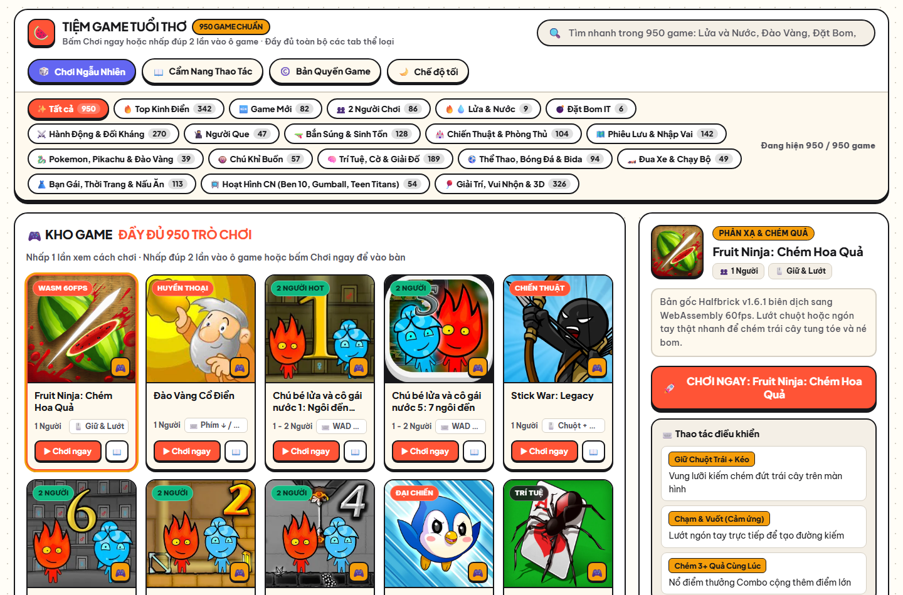
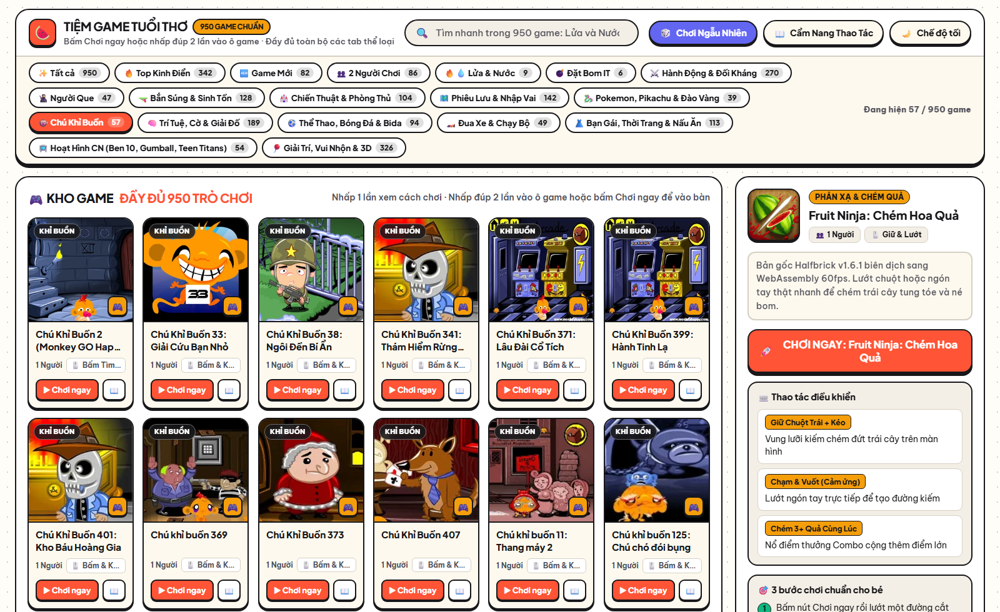
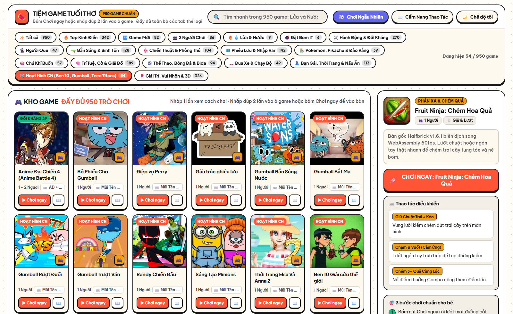
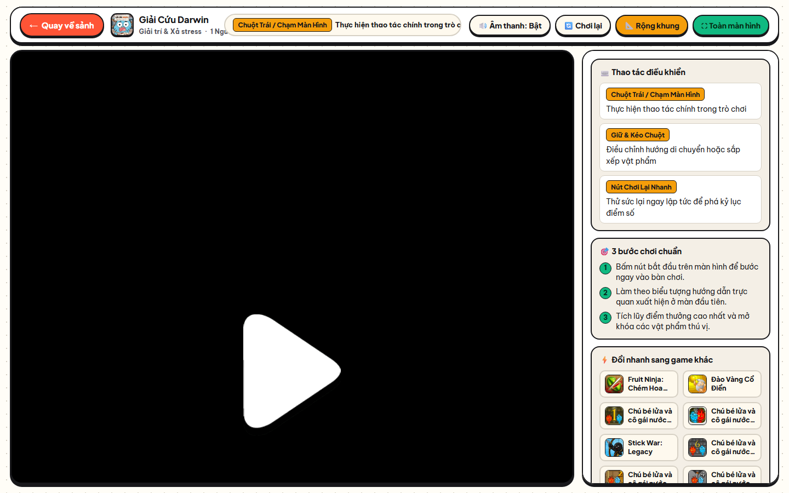
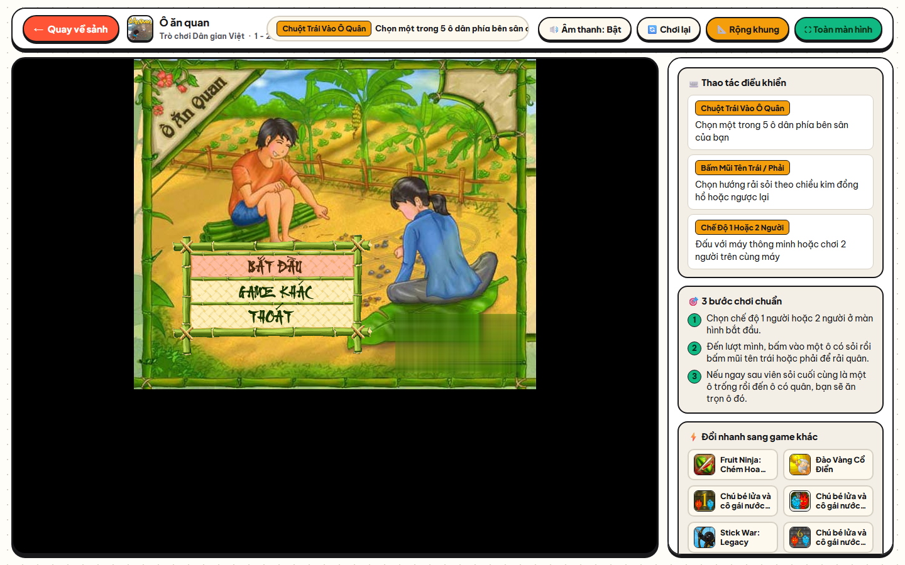
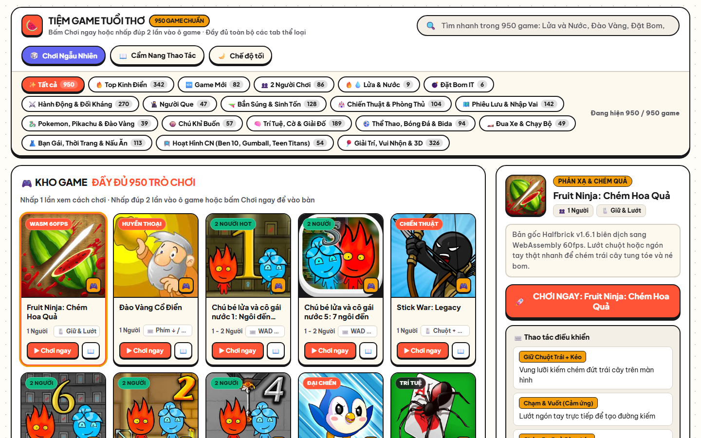
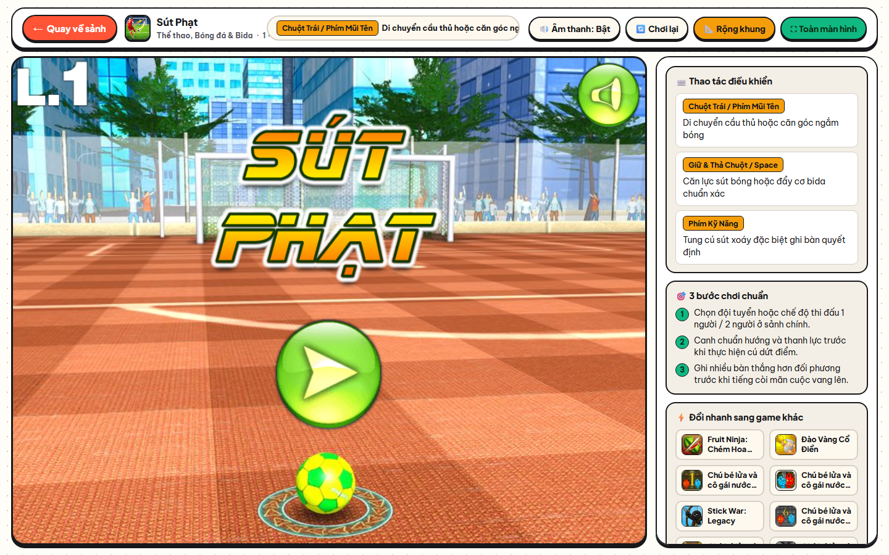
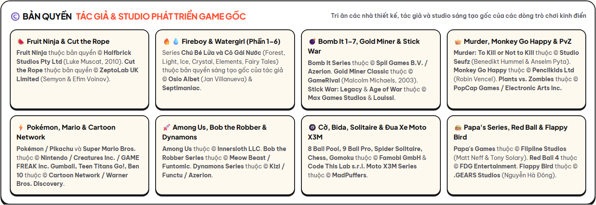

# 🎮 Tiệm Game Tuổi Thơ — Kho 950 Game HTML5 & WebAssembly Thuần Tĩnh (`Pure Static HTML`)

<p align="center">
  <a href="https://onlytrisdev.github.io/tiem-game-tuoi-tho/">
    
  </a>
  
  
  
  
  
</p>

🌐 **Trải nghiệm trực tuyến ngay tại:** **[https://onlytrisdev.github.io/tiem-game-tuoi-tho/](https://onlytrisdev.github.io/tiem-game-tuoi-tho/)**

**Tiệm Game Tuổi Thơ** là cổng lưu trữ và trải nghiệm **950 trò chơi trình duyệt kinh điển** gắn liền với ký ức tuổi thơ và thế hệ GenZ Việt Nam (*Đào Vàng Cổ Điển*, *Chú Bé Lửa và Cô Gái Nước 1–6*, *Đặt Bom Bomb It 1–7*, *Fruit Ninja WASM*, *Ám Sát Nhà Vua — Murder*, *Chú Khỉ Buồn — Monkey Go Happy*, *Giải Cứu Darwin — Gumball*, *Ô Ăn Quan*, *Cờ Caro*, *Pikachu Cổ Điển*, *Cuộc Chiến Xuyên Thế Kỷ*, *Stick War: Legacy*, *Tiệm Bánh Papa's*...).

Toàn bộ dự án được đóng gói theo kiến trúc **100% Pure Static HTML (`index.html`, `style.css`, `assets/`, `games/`)** — **không cần PHP, không cần cơ sở dữ liệu, không cần backend**, có thể chạy trực tiếp trên **GitHub Pages**, **Cloudflare Pages**, **Vercel**, **Netlify**, **Laragon / Apache / Nginx** hoặc bất kỳ máy chủ file tĩnh nào.

---

## 📸 Hình Ảnh Giao Diện & Trải Nghiệm Thực Tế

### 1. Sảnh Chính Kho 950 Game & Thanh Phân Loại 15 Chủ Đề
Giao diện thiết kế theo phong cách **Playful Daylight Neo-Brutalist Bento**, tận dụng toàn bộ không gian màn hình rộng (`max-width: 1920px`, lưới tự động lấp đầy `auto-fill`), hỗ trợ:
- **Click 1 lần** vào nút `Chơi ▶` hoặc **Double-Click (nhấp đúp 2 lần)** vào bất kỳ đâu trên thẻ game để vào chơi ngay lập tức.
- Tìm kiếm tức thì không dấu / có dấu và lọc theo **15 danh mục chuyên biệt** (*Tất cả 950 game*, *Nổi bật*, *2 Người*, *Chiến thuật*, *Hành động*, *Trí tuệ*, *Giải đố*, *Thể thao*, *Đua xe*, *Cổ điển*, *Chú Khỉ Buồn*, *Tiệm Papa's*, *Hoạt hình CN*, *Bắn súng*, *Bạn gái*).



### 2. Chuyên Mục Series Kinh Điển (*Chú Khỉ Buồn — Monkey Go Happy* & *Hoạt Hình Cartoon Network*)
| 🐵 Chuyên mục Chú Khỉ Buồn (*Pencilkids*) | 📺 Chuyên mục Hoạt Hình Cartoon Network (*Gumball, Teen Titans Go!, Ben 10*) |
| :---: | :---: |
|  |  |

### 3. Màn Hình Chơi Game Đã Xóa Sạch 100% Watermark & Quảng Cáo (3-Layer Scrubbing)
Toàn bộ `4,405` tệp hình ảnh/spritesheet trong `games/` đã được quét và làm sạch đa tầng, kết hợp với bộ chặn runtime `clean-runtime.js?v=4`:

| 🎮 *Giải Cứu Darwin (The Amazing World of Gumball)* | 🎲 *Ô Ăn Quan Dân Gian* |
| :---: | :---: |
|  |  |
| 🍉 *Hoa Quả Chiến Đấu (Fruit Fighter)* | ⚽ *Sút Phạt (Free Kick Classic — 100% Local)* |
|  |  |

### 4. Khu Vực Ghi Nhận Bản Quyền Tác Giả & Studio Sáng Tạo Gốc Ngay Trên Trang Chủ


---

## ⚡ Điểm Nổi Bật Về Kỹ Thuật & Hiệu Năng

1. **Kiến trúc 100% Pure Static HTML & 100% Tài Nguyên Local (`Zero Backend / Zero PHP / Zero Third-Party Requests`):**
   - Toàn bộ danh mục **950 trò chơi** được biên dịch tĩnh vào `index.html` (`337 KB` nguyên bản, chỉ `~68 KB` qua nén Gzip/Brotli).
   - Toàn bộ **950 / 950 trò chơi (`90,805` tệp mã nguồn và tài nguyên `.js`, `.css`, `.json`, `.xml`, `.atlas`, `.png`, `.jpg`, `.webp`, `.ogg`, `.mp3`, `.wasm`, `.data`, `.swf`)** được tải và lưu trữ trực tiếp tại máy cục bộ trong `games/<slug>/` — hoàn toàn không sử dụng `<base href>` trỏ ra ngoài và không phát sinh bất kỳ kết nối nào tới máy chủ bên thứ 3.
2. **Hệ thống Lọc & Xóa Watermark 3 Tầng (`3-Layer Watermark & Ad Elimination`):**
   - **Tầng 1 (Static Asset Pixel & Connected-Component Scrubbing):** Quét toàn bộ tệp `.png`, `.jpg`, `.webp` trong `games/` bằng thuật toán phát hiện cụm khối `8x8` đa tỉ lệ (`3x3`, `5x5`, `11x11`) và nội suy biên song tuyến tính (bilinear boundary inpainting), xóa sạch `157` spritesheet bị chèn watermark và `53` tệp logo cổng trung gian mà vẫn bảo toàn nguyên vẹn hình vẽ nhân vật.
   - **Tầng 2 (Runtime WebGL & Canvas Texture Sanitizer — `assets/vendor/clean-runtime.js?v=4`):** Can thiệp trực tiếp vào runtime để chặn toàn bộ kết nối đo lường/quảng cáo ra ngoài và đồng bộ hóa đối tượng SDK cục bộ (`h5api`, `h5ads`, `PokiSDK`, `YaGames`, `LaggedAPI`).
   - **Tầng 3 (Ad-SDK & Popup Neutralizer):** Vô hiệu hóa hoàn toàn `google.ima`, `ima3.js`, `gamemonetize`, `gamedistribution`, `adinplay`, `poki-sdk`, và chặn mọi lệnh `window.open()` dẫn hướng ra ngoài khi người chơi bấm vào vùng trống trong game.
3. **Tốc Độ Tải Siêu Tốc & Kết Xuất Lô (`Chunked DOM Batching`):**
   - Chỉ kết xuất `60` thẻ game đầu tiên ở frame đầu tiên và tự động nạp tiếp theo cuộn trang qua `IntersectionObserver`, giúp thời gian phản hồi HTTP trung vị đạt **`2.49 ms`** và chuyển tab danh mục trong **`< 8 ms`**.

---

## ©️ Bản Quyền Các Tựa Game Gốc & Studio Phát Triển (Original Game Copyright & Attribution)

Dự án **Tiệm Game Tuổi Thơ** cam kết tôn trọng và ghi nhận minh bạch nguồn gốc sáng tạo của các tác giả, nhà thiết kế độc lập và studio phát triển game gốc. **Bản quyền của các trò chơi thuộc về các nhà phát triển và studio sáng tạo gốc dưới đây (tuyệt đối KHÔNG thuộc về các website tổng hợp trung gian):**

| Dòng Game Tiêu Biểu | Tác Giả Thiết Kế & Studio Sáng Tạo Gốc | Năm | Ghi Nhận Bản Quyền (Copyright Holder) |
| :--- | :--- | :---: | :--- |
| **Fruit Ninja (Chém Hoa Quả)** | **Luke Muscat** — **Halfbrick Studios Pty Ltd** (Úc) | 2010 | © Halfbrick Studios Pty Ltd |
| **Cut the Rope (Cắt Dây Cho Ếch Ăn Kẹo)** | **Semyon & Efim Voinov** — **ZeptoLab UK Limited** | 2010 | © ZeptoLab UK Limited |
| **Fireboy & Watergirl (Chú Bé Lửa & Cô Gái Nước 1–6)** | **Oslo Albet (Jan Villanueva)** & **Septimaniac** | 2009–2021 | © Oslo Albet (Jan Villanueva) |
| **Bomb It 1–7 (Đặt Bom)** | **Spil Games B.V. / Azerion Gaming** (Lấy cảm hứng từ *Bomberman* của **Hudson Soft / Konami**) | 2007–2015 | © Spil Games B.V. / Azerion |
| **Gold Miner Classic (Đào Vàng Cổ Điển)** | **Malcolm Michaels** — **GameRival / Grab.com** | 2003 | © Malcolm Michaels / GameRival |
| **Stick War: Legacy & Age of War (Cuộc Chiến Xuyên Thế Kỷ)** | **Jason Whitham, Brock White (Max Games Studios)** & **Louis-Simon Ménard (Louissi)**; Âm nhạc *"Glorious Morning"* bởi **Waterflame** | 2007–2016 | © Max Games Studios, © Louissi & © Waterflame |
| **Murder: To Kill or Not to Kill (Ám Sát Nhà Vua)** | **Benedikt Hummel & Anselm Pyta** — **Studio Seufz GbR** (Đức) | 2014 | © Studio Seufz GbR |
| **Monkey GO Happy (Chú Khỉ Buồn — 190+ phần)** | **Robin Vencel** — **Pencilkids Ltd** (Canada) | 2011–2024 | © Robin Vencel / Pencilkids Ltd |
| **Plants vs. Zombies (Hoa Quả Nổi Giận)** | **George Fan, Rich Werner, Laura Shigihara** — **PopCap Games / Electronic Arts Inc.** | 2009 | © PopCap Games / Electronic Arts Inc. |
| **Among Us** | **Marcus Bromander, Forest Willard, Amy Liu** — **Innersloth LLC** | 2018 | © Innersloth LLC |
| **Pokémon / Pikachu & Super Mario Bros.** | **Satoshi Tajiri, Shigeru Miyamoto, Takashi Tezuka, Koji Kondo** — **Nintendo / Creatures Inc. / GAME FREAK inc.** & **Chen Program Study (CPS)** | 1985–2003 | © Nintendo / Creatures Inc. / GAME FREAK inc. |
| **Gumball (Giải Cứu Darwin), Teen Titans Go!, Ben 10, We Bare Bears** | **Ben Bocquelet, Man of Action, Daniel Chong** — **Cartoon Network Studios / Warner Bros. Discovery** | 2010–2022 | © Cartoon Network / Warner Bros. Discovery |
| **Bob the Robber 1–5 & Money Movers 1–3** | **Alexey Davydov (Flazm), Meow Beast & Funtomic** | 2011–2019 | © Flazm / Meow Beast / Funtomic |
| **Dynamons 1–4 (Đại Chiến Pokemon)** | **Functu** — **Kizi / Azerion Gaming** | 2015–2022 | © Functu / Kizi / Azerion |
| **Papa's Series (Tiệm Bánh, Pizza, Burger, Kem, Sushi...)** | **Matt Neff & Tony Solary** — **Flipline Studios** (Mỹ) | 2007–2023 | © Flipline Studios (Flipline IDS LLC) |
| **Moto X3M 1–6, Football Legends 2021, Basketball Legends** | **MadPuffers** | 2015–2021 | © MadPuffers |
| **8 Ball Pool, 9 Ball Pro, Spider Solitaire, Master Chess, Cờ Caro** | **Famobi GmbH** (Đức) & **Code This Lab s.r.l.** (Ý) | 2014–2022 | © Famobi GmbH & © Code This Lab s.r.l. |
| **Red Ball 4 (Bóng Đỏ Phiêu Lưu)** | **Eugene Fedoseev (Yohoho Games)** & **FDG Entertainment** | 2014 | © Yohoho Games / FDG Entertainment |
| **Flappy Bird** | **Nguyễn Hà Đông** — **.GEARS Studios** (Việt Nam) | 2013 | © .GEARS Studios / Nguyễn Hà Đông |
| **Ô Ăn Quan, Cờ Tướng, Cờ Gánh, Bầu Cua** | **Trò chơi Dân gian Truyền thống Việt Nam** | Truyền thống | Di sản Văn hóa Dân gian Việt Nam |

📄 Xem hồ sơ bản quyền đầy đủ, danh mục engine mã nguồn mở (Ruffle, Emscripten, Phaser, CreateJS, PixiJS) và chính sách liên hệ dành cho tác giả gốc tại **[COPYRIGHT.md](COPYRIGHT.md)** và **[LICENSE](LICENSE)**.

---

## 📂 Cấu Trúc Thư Mục (`Clean Static Repository Layout`)

```text
tiem-game-tuoi-tho/
├── index.html                        # Cổng chính 100% Pure Static HTML5 (950 game, 15 chuyên mục, mục Bản quyền)
├── style.css                         # Hệ thống giao diện Playful Daylight Neo-Brutalist Bento (Responsive)
├── .htaccess                         # Cấu hình MIME types (WASM/WebP) & Cache-Control cho Apache/Laragon
├── .nojekyll                         # Tắt bộ xử lý Jekyll để phục vụ trực tiếp trên GitHub Pages
├── README.md                         # Tài liệu hướng dẫn, hình ảnh giao diện & bảng ghi nhận bản quyền
├── COPYRIGHT.md                      # Hồ sơ nghiên cứu bản quyền tác giả & studio sáng tạo game gốc chi tiết
├── LICENSE                           # Giấy phép MIT cho phần khung giao diện & Phụ lục bảo hộ IP game gốc
├── decisions.tsv                     # Nhật ký quyết định kỹ thuật và số liệu kiểm chứng (Decision Trail)
├── docs/
│   └── screenshots/                  # Ảnh chụp màn hình thực tế của sảnh chính, các chuyên mục và màn chơi
├── assets/
│   ├── thumbs/                       # 950 ảnh đại diện .webp & .svg tối ưu tốc độ tải (< 3 KB/ảnh)
│   └── vendor/
│       ├── clean-runtime.js          # Bộ lọc WebGL/Canvas texture watermark & chặn Ad-SDK/Popup (v4)
│       └── ruffle/                   # Bộ giả lập Ruffle WebAssembly cục bộ cho các tựa game Flash (.swf)
└── games/                            # 950 thư mục trò chơi độc lập (games/<slug>/index.html)
```

---

## 🚀 Hướng Dẫn Chạy Thử & Triển Khai (`Quick Start & Deployment`)

Vì toàn bộ mã nguồn là **HTML5 tĩnh 100%** với đường dẫn tương đối chuẩn, bạn có thể chơi trực tiếp hoặc triển khai trên bất kỳ môi trường nào:

### Cách 1: Chơi trực tiếp trên GitHub Pages
Truy cập ngay tại: **[https://onlytrisdev.github.io/tiem-game-tuoi-tho/](https://onlytrisdev.github.io/tiem-game-tuoi-tho/)**

### Cách 2: Chạy bằng Web Server bất kỳ (Apache / Nginx / Laragon / Cloudflare Pages / Vercel)
Clone kho lưu trữ vào thư mục gốc của web server (`public_html/`, `www/`, hoặc `htdocs/`) và mở trình duyệt tại địa chỉ máy chủ của bạn:
```bash
git clone https://github.com/onlytrisdev/tiem-game-tuoi-tho.git
```

### Cách 3: Chạy nhanh bằng Python hoặc Node.js Static Server
```bash
# Dùng Python 3
python -m http.server 8080

# Hoặc dùng Node.js serve
npx serve . -l 8080
```
Sau đó mở trình duyệt tại `http://localhost:8080`.
